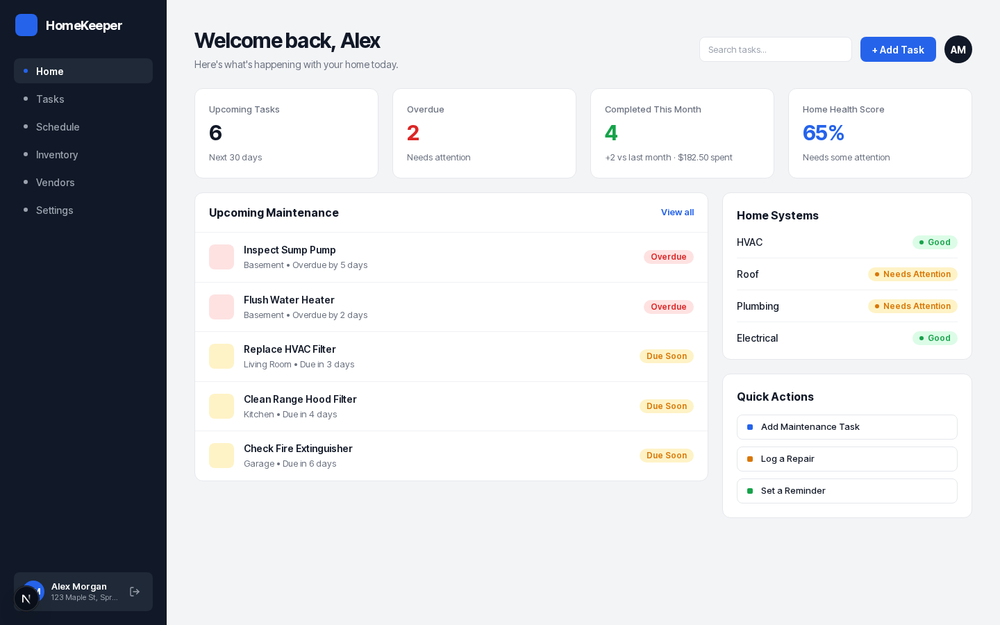

# HomeKeeper

A home-maintenance tracker. Keep a schedule of recurring chores, an inventory of the things in your house, and a list of the vendors you hire, and get an email before something is due.

**Live:** https://homekeeper-sage.vercel.app



## Features

- **Home:** overdue and upcoming tasks, a home health score, this month's completions and spending, and quick actions such as logging a repair.
- **Tasks:** one-off or repeating tasks (every N days, weeks, months or years) linked to an item and a vendor. Completing a task records the cost, the vendor and a receipt photo, and schedules the next occurrence.
- **Schedule:** a month calendar, or a list view, of upcoming tasks.
- **Inventory:** appliances and systems with model, category, install year and condition, plus each item's repair history and total cost.
- **Vendors:** contacts for the people you hire, and when you last hired each one.
- **Settings:** profile and photo, email reminder and weekly summary preferences, password change, and account deletion.
- **Email:** a daily cron sends reminders for upcoming tasks, and a weekly summary on the same schedule.

## Stack

| Concern | Choice |
|---|---|
| App | Next.js 16 (App Router, Server Actions, `proxy.ts` route guard), React 19, Tailwind 4 |
| Data | Postgres via Drizzle ORM: Neon in production, [PGlite](https://pglite.dev) (in-process Postgres) locally |
| Auth | Better Auth, email and password |
| Files | Vercel Blob, client uploads through `/api/upload` |
| Email | Resend and React Email; Vercel Cron calls `/api/cron/reminders` daily at 13:00 UTC |
| Tests | Vitest (domain logic and server actions), Playwright (end-to-end, desktop and mobile) |

## Running locally

Local development needs no accounts or services: the database is a PGlite folder in `.pglite/`, emails are printed to the terminal instead of sent, and photo uploads show an error but everything else works.

```bash
npm install
cp .env.example .env.local     # then set BETTER_AUTH_SECRET: openssl rand -base64 32
npm run db:migrate             # create the tables in .pglite/dev
npm run db:seed                # optional: demo user with sample data
npm run dev
```

Open http://localhost:3000. The seeded demo account is `alex.morgan@email.com` / `homekeeper-demo`.

## Scripts

| Command | What it does |
|---|---|
| `npm run dev` | Start the dev server |
| `npm run build` / `npm start` | Production build and server |
| `npm run lint` | ESLint |
| `npm test` | Vitest; each worker gets a fresh in-memory database |
| `npm run e2e` | Playwright; starts the dev server if it isn't running |
| `npm run db:generate` | Create a migration in `drizzle/` after editing `lib/db/schema.ts` |
| `npm run db:migrate` | Apply migrations to `DATABASE_URL` |
| `npm run db:studio` | Browse the database in Drizzle Studio |
| `npm run db:seed` | Recreate the demo user and their data |

To run the end-to-end tests against the live site instead of localhost:

```bash
PLAYWRIGHT_BASE_URL=https://homekeeper-sage.vercel.app npm run e2e
```

These tests create accounts ending in `@example.com`. The journey test deletes its account, but the auth tests don't. To clear them out, run `delete from "user" where email like '%@example.com';` in the Neon SQL editor; each user's data is deleted with them.

## Project layout

```
app/(marketing)/   landing, sign up, forgot and reset password
app/(app)/         signed-in pages: home, tasks, schedule, inventory, vendors, settings
app/api/           auth, Blob upload, and the reminders cron
app/ui/            shared components
lib/data/          reads (server-only, scoped to the signed-in user's home)
lib/actions/       writes (Server Actions with zod validation)
lib/domain/        pure logic: recurrence, due dates, totals
lib/db/            Drizzle schema and client
emails/            React Email templates
drizzle/           SQL migrations
e2e/               Playwright tests
test/              Vitest tests
docs/              build plan, per-lane briefs, design screenshots
```

## Deploying to Vercel

The project is linked to the Vercel project `homekeeper`, and pushes to `main` deploy to production.

**First-time setup.** `scripts/vercel-setup.sh` walks through it step by step: log in, link the project, add Neon and Blob from the Storage tab, then set the Resend key and generate the secrets. For reference, production needs:

| Variable | Source |
|---|---|
| `DATABASE_URL` | Added by the Neon integration |
| `BLOB_STORE_ID` | Added when the Blob store is connected (OIDC; no read-write token needed) |
| `RESEND_API_KEY` | Resend dashboard |
| `EMAIL_FROM` | Sender address, for example `HomeKeeper <reminders@yourdomain.com>` |
| `BETTER_AUTH_SECRET` | `openssl rand -base64 32` |
| `BETTER_AUTH_URL` | The production URL |
| `CRON_SECRET` | `openssl rand -hex 32`; Vercel Cron sends it as a Bearer token |

**Migrations** run during the production build: the `vercel-build` script runs `scripts/migrate.ts`, then `next build`. Neon's connection string is a sensitive variable, so `vercel env pull` can't download it, and migrating from your machine isn't an option. Preview builds skip migrations because they share the production database.

**Email** only reaches the Resend account owner while `EMAIL_FROM` uses `onboarding@resend.dev`. To email anyone else, verify a domain in Resend and update `EMAIL_FROM`.
